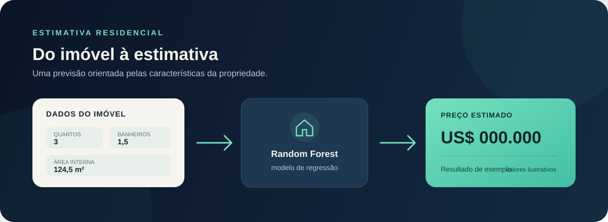

# Predição de preço de imóveis

Aplicativo em Streamlit que estima o preço de imóveis com um modelo de Machine Learning treinado com dados de Seattle, nos Estados Unidos.



## Como funciona

1. Informe as características do imóvel, como quartos, banheiros, áreas e condição.
2. O aplicativo prepara os dados e executa o modelo Random Forest Regressor.
3. Veja a estimativa em dólares e, quando a cotação estiver disponível, o valor aproximado em reais.

O app também apresenta as características mais importantes para o modelo. Como o treinamento usa imóveis de Seattle, a estimativa pode não representar bem imóveis de outras regiões.

## Executar localmente

Ative seu ambiente Python e instale as dependências:

```bash
pip install -r requirements.txt
```

Inicie o Streamlit na pasta do projeto:

```bash
streamlit run app.py
```

O modelo carregado pelo app fica em `model/model_price/`. Essa cópia permite executar o aplicativo sem conectar ao servidor MLflow do computador.

## Publicar no Streamlit Community Cloud

Conecte o repositório ao Streamlit Community Cloud e configure:

- **Main file path:** `app.py`
- **Branch:** `main`

O modelo em `model/model_price/` precisa permanecer no repositório para o aplicativo publicado conseguir carregá-lo. `mlartifacts/`, `mlflow.db` e `.venv/` são arquivos locais ignorados pelo Git.

## Estrutura principal

```text
.
├── app.py
├── assets/
│   └── fluxo-do-app.svg
├── data/
├── model/
│   ├── model_price/
│   ├── predict.py
│   └── train.py
└── requirements.txt
```
